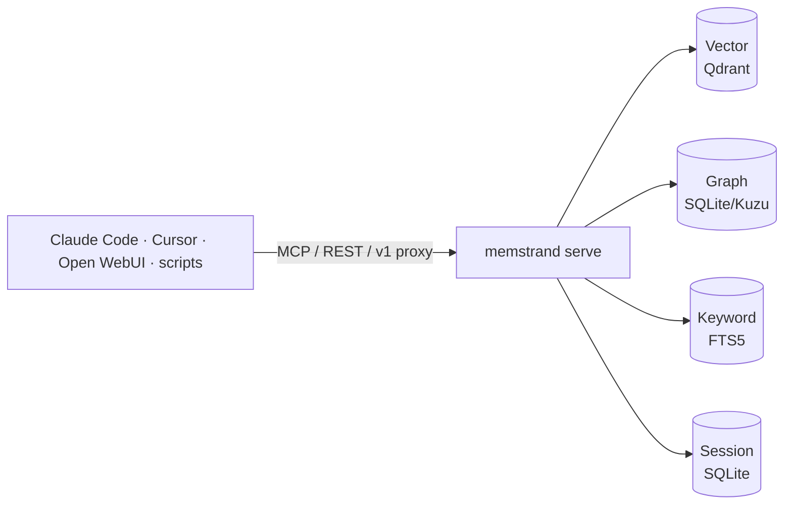

<p align="center">
  
</p>

<p align="center"><strong>Local-first memory for AI agents. Typed, scoped, and it never leaks one task into another.</strong></p>

<p align="center">
  <a href="https://pypi.org/project/memstrand/"></a>
  <a href="https://pypi.org/project/memstrand/"></a>
  <a href="LICENSE"></a>
  <a href="https://github.com/chiranjeevirajukr/memstrand/actions/workflows/ci.yml"></a>
</p>

<p align="center">
  <a href="#quickstart">Quickstart</a> ·
  <a href="#docs">Docs</a> ·
  <a href="docs/integrations.md">Integrations</a>
</p>

<!-- DEMO: re-enable once docs/assets/demo.svg is generated (make demo)
<p align="center" id="demo">
  
</p>
-->

## Why memstrand

Flat vector memory has three failure modes, and every agent hits all three:

- **No types** — a preference, a decision, and a guess all look the same to cosine similarity.
- **No scope** — a fact learned while testing Playwright leaks into an unrelated Mac disk-cleanup session. (This actually happened. It's why this exists.)
- **No provenance** — nobody knows whether a memory was *said*, *inferred*, or *corrected*, or how confident the agent was.

memstrand fixes all three: every memory is **typed** (13 categories),
**scoped** (session/task/host, a hard filter — not a ranking signal), and
**carries provenance** (how it was learned, confidence, expiry). One
daemon (`memstrand serve`) shares all of that across Claude Code, Cursor,
Open WebUI, and your own scripts — over MCP, REST, and an OpenAI-compatible
proxy — backed by an embedded, on-disk store. No Docker, no cloud, no API
keys.

## Quickstart

```bash
pip install memstrand
```

```python
from memstrand import Category, Memory, Provenance

mem = Memory.in_memory()

# A fact scoped to one task...
mem.remember(
    "Playwright installed as an agent-testing task dependency",
    category=Category.fact,
    provenance=Provenance.explicit_statement,
    task_id="playwright-test",
)

# ...and a global preference
mem.remember(
    "Chiran prefers a natural, unstylized look in AI portraits",
    category=Category.preference,
    provenance=Provenance.explicit_statement,
    confidence=0.95,
)

# An unrelated session asks about testing setup.
# The Playwright fact does NOT leak across the task boundary:
for hit in mem.recall("testing setup"):
    print(hit["category"], "-", hit["content"])
# preference - Chiran prefers a natural, unstylized look in AI portraits

# Same query WITH the task scope sees it:
for hit in mem.recall("testing setup", task_id="playwright-test"):
    print(hit["category"], "-", hit["content"])
# fact - Playwright installed as an agent-testing task dependency
```

`Memory.in_memory()` runs Qdrant in `:memory:` mode and the graph/session/
keyword stores in a temp SQLite file — nothing touches disk and nothing
persists past the process. Embeddings are local ONNX (fastembed) by
default, downloaded once on first use.

### Make it your second brain

```bash
memstrand serve                                                    # one daemon: MCP + REST + web UI + OpenAI proxy
claude mcp add --transport http memstrand http://127.0.0.1:7777/mcp  # Claude Code
# Open WebUI -> Admin Settings -> Connections -> OpenAI API -> Base URL http://127.0.0.1:7777/v1
memstrand ingest ~/notes --watch                                   # keep your notes/Obsidian vault synced in
```

Full setup recipes (Ollama/llama.cpp/LM Studio, Cursor, launchd/systemd
autostart, cron backups) are in [docs/integrations.md](docs/integrations.md).

## Features

- 100% local, zero API keys — embedded Qdrant + SQLite, local ONNX embeddings by default
- Typed (13 categories) + full provenance (how it was learned, confidence, expiry)
- Hard scope isolation — session/task/host is a filter applied before ranking, not a signal
- Hybrid search (dense + BM25) with absolute, non-normalized relevance + optional reranking
- Learns from your sessions — Claude Code hooks + OpenAI-proxy distillation, not just manual writes
- Ingests notes, Obsidian vaults, and PDFs, with `--watch` for continuous sync
- Web UI for browsing, searching, and editing memories
- MCP + REST + OpenAI-compatible proxy, all from one daemon
- Contradictions and corrections are edges, never deletes — old memories stay queryable
- `export` / `import` / `backup` / `restore` for full portability

## How it compares

| | memstrand | Mem0 | Cognee | raw vector RAG |
|---|---|---|---|---|
| Local-first, no API keys | ✅ | OSS self-host option | ✅ | ✅ |
| Typed memory schema | ✅ 13 categories | ✅ notes | ✅ ontology | ❌ |
| Scope enforcement (hard filter) | ✅ | ❌ | ❌ | ❌ |
| Graph + vector joint writes | ✅ | ✅ | ✅ | ❌ |
| Contradictions as edges, not deletes | ✅ | ❌ | ✅ | ❌ |
| Hybrid (dense + BM25) retrieval, built in | ✅ | — | — | ❌ |
| One daemon shared across tools (MCP + REST + OpenAI proxy) | ✅ | — | — | ❌ |

## How it works



**Write** (`remember()`) embeds once and writes vector+graph+keyword under
one scope-aware content-hash id. **Distill** (`improve()`) extracts typed
atoms from raw session turns via your local LLM and promotes them with
`supersedes`/`contradicts` edges. **Read** (`recall()`) applies the hard
scope filter first, then blends hybrid relevance with confidence, recency,
provenance, and access frequency. **Consolidate** expires, decays, dedups,
and replays on a schedule. Full detail, including the ranking formula and
FSRS/Hebbian dynamics, in [docs/architecture.md](docs/architecture.md).

## Docs

- [docs/configuration.md](docs/configuration.md) — every `MEMSTRAND_*` environment variable
- [docs/architecture.md](docs/architecture.md) — stores, write/distill/read/consolidate paths, ranking formula
- [docs/python-api.md](docs/python-api.md) — the full `Memory` method surface
- [docs/cli.md](docs/cli.md) — every CLI command/flag, plus REST/MCP reference and security notes
- [docs/integrations.md](docs/integrations.md) — Ollama/llama.cpp/LM Studio, Claude Code, Cursor, Open WebUI, autostart, backups, Obsidian

## Acceptance test

Any memory system should pass these three before you trust it (rubric
adapted from a Cognee ad, because it was right):

1. **Remember me in a brand-new chat** without re-pasting anything.
2. **Search by meaning**, not keywords.
3. **Connect facts across sessions** — and *don't* leak facts across unrelated tasks (the Playwright test).

`examples/quickstart.py` runs all three against a persistent store;
`tests/test_memory_flow.py` runs the same rubric in CI.

## Roadmap

- [x] Typed schema, scoped retrieval, provenance ledger
- [x] Session-commit distillation (extract → dedup → judge → promote)
- [x] Graph neighbor hydration, Hebbian strengthen/decay, FSRS + replay consolidation
- [x] One daemon: MCP + REST + web UI + OpenAI-compatible memory-injecting proxy
- [x] Hybrid (dense + BM25) retrieval + optional cross-encoder reranking
- [x] Markdown/Obsidian/PDF ingestion with `--watch`
- [x] Claude Code hooks, `export`/`import`/`backup`/`restore`
- [ ] Automated migration tooling from 0.1.x's working-directory layout — see [CHANGELOG.md](CHANGELOG.md) (good first issue)
- [ ] Multi-user auth beyond a single shared bearer token (good first issue)

Contributions welcome — see [CONTRIBUTING.md](CONTRIBUTING.md) for dev
setup, test philosophy, and how to add a store backend.

## Acknowledgments

Standing on shoulders, with credit:

- **Memanto** (moorcheh-ai/memanto) — the 13-category typed schema, provenance, and confidence model. Their product is cloud-only; this is the schema reimplemented local-first.
- **Cognee** (topoteretes/cognee) — the pipeline patterns: fast session cache → distillation, joint graph+vector writes, contradictions as additive edges.
- **ZenBrain** (zensation-ai/zenbrain) — per-fact FSRS, deterministic write routing, replay consolidation, Hebbian edges.
- **Mem0** — the ADD/UPDATE/DELETE/NONE extraction resolution pattern.

## License

MIT — see [LICENSE](LICENSE).

---

If memstrand saves you from re-explaining yourself to your agent, a ⭐ helps others find it.
