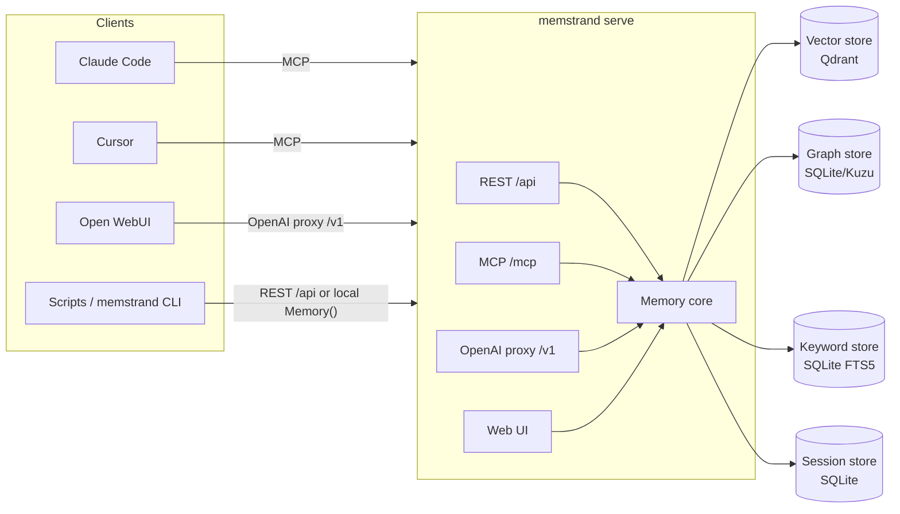

# Architecture

## Stores

Four swappable stores behind thin protocols (`src/memstrand/stores/base.py`),
sharing `$MEMSTRAND_HOME` by default:

| Store | Default backend | Role |
|---|---|---|
| Vector | Qdrant (embedded on-disk, or `MEMSTRAND_QDRANT_URL`) | dense semantic search over atom embeddings; scope + TTL filters are baked into every query |
| Graph | SQLite (optional: Kuzu via `memstrand[kuzu]`) | atoms, typed edges, FSRS memory-strength state, access stats |
| Keyword | SQLite FTS5 | BM25 lexical search, fused with vector search |
| Session | SQLite (same file as the graph store) | raw per-session turns (`log_turn`) + an append-only provenance ledger |

Each store is a `Protocol` (duck-typed interface), not an abstract base class
— see [CONTRIBUTING.md](../CONTRIBUTING.md) for how to add a new backend
behind one of these.

## Clients, daemon, stores

Embedded Qdrant/SQLite are single-writer, so the daemon (`memstrand serve`)
is what lets Claude Code, Cursor, Open WebUI, and the CLI all share one
memory store safely. `memstrand.client.get_memory()` returns a
`RemoteMemory` (same method surface, talks to the daemon over REST) if a
daemon is reachable, else falls back to a local `Memory()` — this is how the
CLI and hooks avoid corrupting a daemon's state when both might run at once.
`Memory.__init__` constructs the vector store eagerly and raises
`StoreLocked` immediately if another process already holds the on-disk
Qdrant lock for that `MEMSTRAND_HOME` — `serve()` and the CLI/client both
turn that into one clean error message and exit, rather than racing the
first process's stores or crashing on a raw Qdrant lock string.

## Write path

`remember()` embeds the content once and writes the atom to the vector,
graph, and keyword stores under one content-hash id
(`mem:<sha256(content + host)>`), then logs the write to the provenance
ledger. An atom carries a *set* of scopes (repo keys, named tasks, and/or
the global member — see [design/scoping-v2.md](design/scoping-v2.md)):
remembering identical content again merges into the same atom, widening its
scope set to the union, so a fact learned in a second repo becomes visible
there without a duplicate. `log_turn()` is just an append — no embedding,
no extraction — so a live chat session costs nothing until it's distilled.

## Distillation (`improve()`)

Extracts typed candidate atoms from a session's new turns via your local
LLM, checks each candidate against similar existing memories with a second
"judge" LLM call (add / update / delete / none — Mem0's resolution
pattern), and promotes survivors with `supersedes` or `contradicts` edges
as needed. Nothing is ever silently deleted — corrections and
contradictions are additive edges, and the old atom stays queryable.
Distillation only promotes content from **user** turns into global
(task-less) standing instructions/preferences — assistant turns can still
become scoped memories, but never silently become something the agent
"told itself" to always do. Standing instructions are further restricted
to trusted provenance (`explicit_statement`, `validated`, or `corrected`)
— an `inferred`, `observed`, or `imported` atom is never treated as a
standing instruction, however confident the extraction was.

## Read path (`recall()`)

Scope (session/task/host) is a hard filter applied *before* ranking, not a
ranking signal — a scoped query sees its own scope plus globals; an
unscoped query sees only globals (the Playwright-bug fix — see the README's
"Why memstrand"). Dense and keyword search run in parallel; relevance is
computed as an *absolute* signal per candidate (not normalized within the
result set — a lone weak match no longer scores a perfect 1.0 just for
being "the best of one"), and hits below `MEMSTRAND_MIN_RELEVANCE` are
dropped. One hop of graph neighbors is hydrated onto every result
(neighbors outside the query's scope are dropped — the scope guarantee
applies to hydration, not just the initial match); contradictions are
surfaced, never hidden.

## Memory dynamics (`consolidate()`)

Per-atom FSRS state (difficulty/stability/next-review) updates on every
successful recall; a scheduled pass expires TTL'd atoms, decays and prunes
weak Hebbian edges (`strengthen_edge`/`decay_edges`), links near-duplicate
atoms (cosine ≥ 0.95, same scope + category) via `supersedes` instead of
deleting, and replays the highest-priority due atoms to keep them stable.
The daemon runs this every `MEMSTRAND_CONSOLIDATE_HOURS`, plus background
`improve()` for any pending sessions.

## Retrieval & ranking

`recall()`'s final score blends five signals (`ranking.blended_score`):

- **0.65 relevance** — an *absolute* 0..1 signal, not normalized within the
  result set (a single weak candidate can't score a perfect 1.0 just for
  being "the best of one"). With `MEMSTRAND_RERANK_MODEL` set, it's
  `sigmoid(cross-encoder score)`; otherwise it's `max(clipped cosine
  similarity, keyword strength = bm25/(bm25+2))`, plus a small bonus when
  both the dense and keyword retrievers find the same atom
  (`ranking.absolute_relevance`).
- **0.12 confidence** — the atom's stored confidence
- **0.10 recency** — exponential decay, 90-day half-life, off whichever of
  `updated_at`/`last_accessed_at` is newer
- **0.08 provenance** — explicit/validated/corrected > observed > imported
  > inferred
- **0.05 access frequency** — capped at 10 accesses

`MEMSTRAND_RERANK_MODEL` and recall's `limit`/`include_superseded` aside,
`MEMSTRAND_MIN_RELEVANCE` (or `recall(min_relevance=...)`) drops hits whose
relevance score falls below the threshold before blending — default `0.0`
(no filtering), since the right cutoff is model-dependent (cosine
distributions differ across embedding models). Superseded atoms are
excluded by default (`include_superseded=True` to see them, at half score)
and TTL-expired atoms never come back.

## Typed schema

Every memory is an "atom" with one of 13 categories (`instruction`, `fact`,
`decision`, `goal`, `commitment`, `preference`, `relationship`, `context`,
`event`, `learning`, `observation`, `artifact`, `error`) and one of 6
provenance values (`explicit_statement`, `inferred`, `corrected`,
`validated`, `observed`, `imported`) — see `src/memstrand/schema.py`. Atoms
are connected by typed edges (`informs`, `supports`, `contradicts`,
`extends`, `supersedes`, `related_to`, `precedes`); contradictions and
corrections are additive edges, never deletes.

See also: [docs/configuration.md](configuration.md) for every
`MEMSTRAND_*` variable, [docs/python-api.md](python-api.md) for the
in-process API, and [docs/cli.md](cli.md) /
[docs/integrations.md](integrations.md) for the REST/MCP/CLI surfaces.
